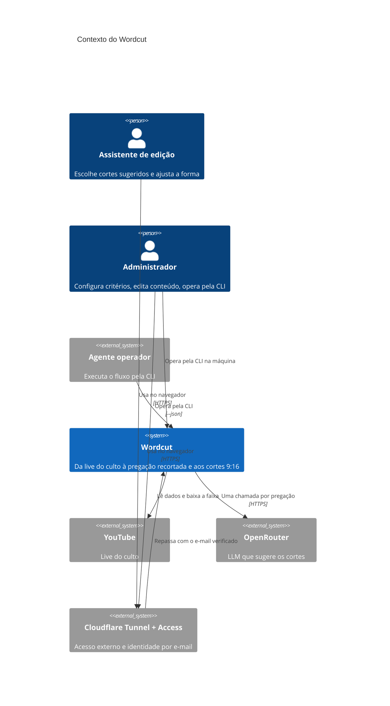
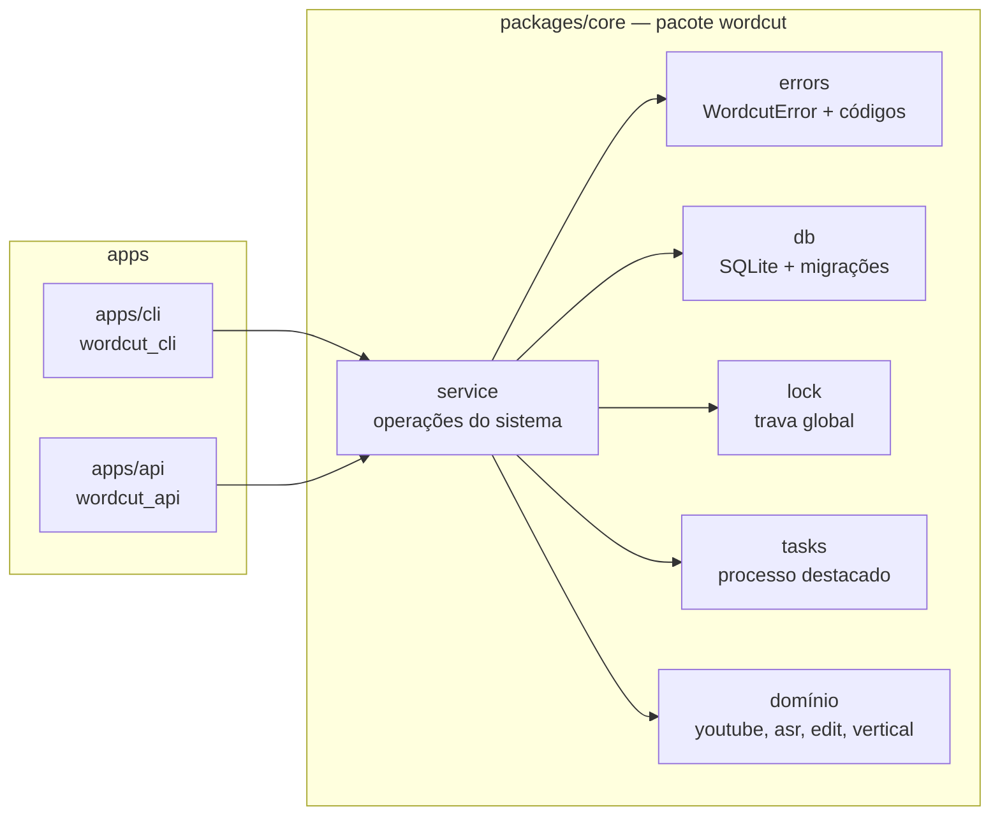
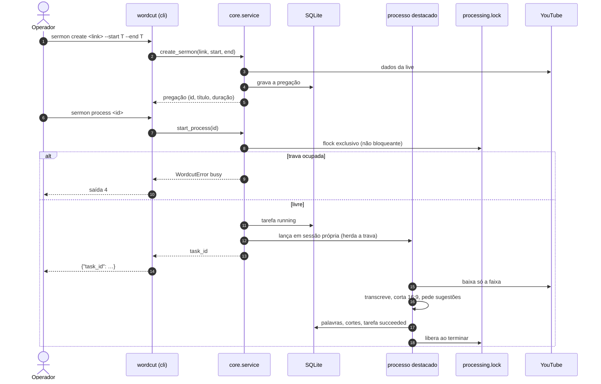

# Arquitetura do Wordcut

Modelo C4 e fluxos principais. As decisões que levam a esta forma estão nas
[ADRs](../adr/README.md). Este documento descreve a arquitetura **alvo do MVP**; a coluna
"Estado" da seção 4 diz o que já existe.

## 1. Contexto (C4 nível 1)



## 2. Contêineres (C4 nível 2)


`api` e `cli` usam o mesmo pacote `core` (camada de serviço e domínio), em processos
separados. O que os coordena é o volume de dados: o banco SQLite e a trava `flock`.

## 3. Componentes do core (C4 nível 3)



## 4. Estado da implementação

| Peça | Estado |
|---|---|
| Monorepo (workspace `uv` com lock único; `apps/web` com npm) | existe |
| Docker Compose (`api`, `web`, `cli` no perfil `tools`; portas só em `127.0.0.1`) | existe; sem GPU e sem WhisperX na imagem (roadmap, item 5) |
| Domínio (`youtube`, `asr`, `edit`, `vertical`) | existe em `packages/core`, herdado da CLI anterior |
| Camada de serviço, banco, trava, tarefas | em construção (roadmap, fase 1) |
| CLI | a anterior, movida para `apps/cli`; a nova (`docs/cli.md`) em construção (roadmap, fase 1) |
| API | esqueleto em `apps/api` com `GET /api/health`; rotas planejadas (roadmap, fase 2) |
| Web | esqueleto em `apps/web` que mostra o estado da API; protótipo em `docs/prototype/wordcut.html`; interface planejada (roadmap, fase 3) |

## 5. Fluxos

### 5.1. Criar e processar uma pregação pela CLI



### 5.2. Exportar um corte pela web

```mermaid
sequenceDiagram
  autonumber
  actor A as Assistente
  participant Web as web
  participant API as api
  participant SVC as core.service
  participant Lock as processing.lock
  participant DB as SQLite

  A->>Web: Exportar (opções)
  Web->>API: POST /api/cuts/{id}/renders
  API->>SVC: start_render(cut_id, options)
  SVC->>Lock: flock exclusivo
  alt ocupada
    API-->>Web: 409 {"error": {"code": "busy"}}
  else livre
    SVC->>DB: opções salvas no corte; tarefa running
    API-->>Web: 202 {"task_id": …}
    Web->>API: GET /api/tasks/{id}/events (SSE)
    loop progresso
      API-->>Web: event: progress
    end
    SVC->>DB: exportação registrada; tarefa succeeded
    API-->>Web: event: done (render_id)
  end
```
