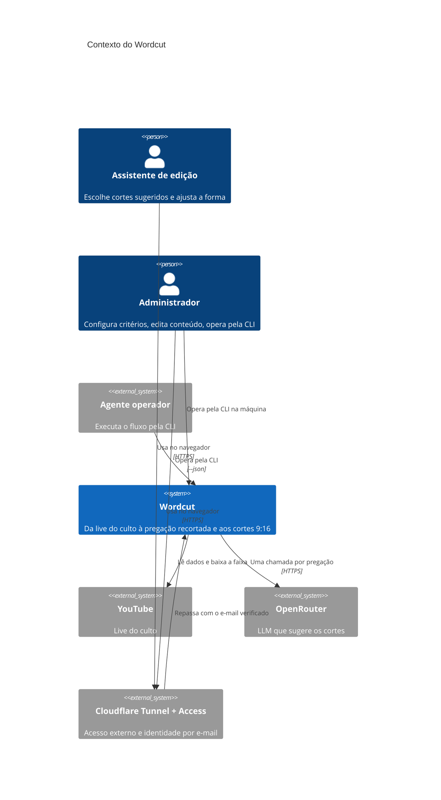
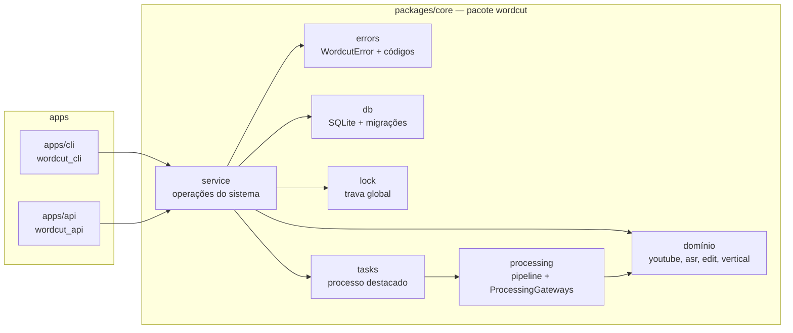

# Arquitetura do Wordcut

Modelo C4 e fluxos principais. As decisões que levam a esta forma estão nas
[ADRs](../adr/README.md). Este documento descreve a arquitetura **alvo do MVP**; a coluna
"Estado" da seção 4 diz o que já existe.

## 1. Contexto (C4 nível 1)



## 2. Contêineres (C4 nível 2)


`api` e `cli` usam o mesmo pacote `core` (camada de serviço e domínio), em processos
separados. O que os coordena é o volume de dados: o banco SQLite e a trava `flock`.

## 3. Componentes do core (C4 nível 3)



## 4. Estado da implementação

| Peça | Estado |
|---|---|
| Monorepo (workspace `uv` com lock único; `apps/web` com npm) | existe |
| Docker Compose (`api`, `web`, `cli` no perfil `tools`; portas só em `127.0.0.1`) | existe; sem GPU e sem WhisperX na imagem (roadmap, item 5) |
| Domínio (`youtube`, `asr`, `edit`, `vertical`) | existe em `packages/core`, herdado da CLI anterior |
| Erros (`errors`), raiz de dados (`home`), banco com migrações (`db`), trava global (`lock`) | existe em `packages/core` (item 3.1.a.3; ADR-0005, ADR-0006) |
| Tabela `sermons` (migração 0002, repositório `db.sermons`) e pasta de segredos (`config`, `WORDCUT_CONFIG`) | existe em `packages/core` (item 1.1.a.1) |
| Configurações | tabela `settings` chave-valor (migração 0005, repositório `db.settings`) com o modelo do LLM (sem padrão) e o do WhisperX (`large-v3` por padrão); segredos em arquivos de `WORDCUT_CONFIG` com permissão 600 (`openrouter-key` e `youtube-cookies.txt`), gravados de uma vez por `config.write_secret` (temporário na mesma pasta + `os.replace`); a chave só sai mascarada (`••••` e os 4 últimos), os cookies só como presentes ou ausentes; pasta somente leitura dá `config_not_writable` (item 2.1.a.1) |
| Critérios e presets | `wordcut.criteria`: textos do prompt no pacote (`criteria/texts/`: `base.md` com vagas para os critérios e as durações, um arquivo por critério com os três níveis, `options/` com reordenar, palavras protegidas e instruções), carregados e validados no primeiro uso (`CatalogError` é erro de programação); tabela `presets` (migração 0006, repositório `db.presets`) com os níveis em JSON por ID de critério, índice único parcial para um só padrão e o "Padrão" semeado com `levels '{}'`; `service.presets` lista, mostra, cria, altera, troca o padrão, apaga (o padrão não), completa critérios novos e ignora removidos na leitura e monta o prompt (`build_prompt`) para a sugestão do item 9; o texto dos critérios aguarda revisão humana qualificada (item 2.1.a.2) |
| Camada de serviço | `service.status` (trava e tarefas em andamento), `service.sermons` (criar a pregação pelo link, listar, detalhar com a última tarefa e a transcrição, delimitar e reconciliar a pregação `processing` órfã; itens 1.1.a.1, 1.1.b, 1.1.c.1), `service.processing` (lançar o processamento; item 1.1.c.1), `service.settings` (ver e trocar os modelos, gravar a chave do LLM e os cookies; item 2.1.a.1), `service.presets` (critérios e presets; item 2.1.a.2) e `service.tasks` (listar, detalhar e esperar tarefas; item 3.1.a.2) existem; as demais operações em construção (roadmap, fase 1) |
| Tarefas | tabela `tasks` (migração 0003) e `wordcut.tasks`: registro de tipos, execução em primeiro plano ou em processo destacado que herda a trava (`wordcut.tasks.runner`, saída em `tasks/<id>.log`), gancho `admit` sob a trava antes de gravar a tarefa, progresso no banco e tarefa órfã marcada `interrupted` na leitura; o tipo interno `diagnostic` exercita o mecanismo; o tipo `process` existe (item 1.1.c.1); `render` e `suggest` chegam com as operações (item 3.1.a.2; ADR-0007, ADR-0013, ADR-0014) |
| Processamento da pregação | `wordcut.processing`: `pipeline.process` (baixa só a faixa e uma janela de áudio, sincroniza, transcreve, ajusta as bordas às palavras e corta com fades), frases (`processing.sentences`, reaproveitadas por `overview`) e a porta `ProcessingGateways` com `LocalGateways`/`default_gateways(whisper_model)`, que transcreve com o modelo do WhisperX das configurações (item 2.1.a.1); tabelas `words` e `sentences` e colunas `sermon_start`, `sermon_end`, `video_path`, `processed_at` em `sermons` (migração 0004, repositório `db.transcripts`); mídias em `media/sermons/<id>/` na pasta de dados; a sugestão de cortes pelo LLM ao fim chega no item 9 (item 1.1.c.1; ADR-0014) |
| CLI | contrato de saída e erros (ADR-0012), erro de uso sem repetir valor digitado (ADR-0015), `wordcut status`, `wordcut sermon create` (com `--process`), `list`, `show` (com `--transcript`), `trim` e `process`, `wordcut task list`, `show` e `wait`, `wordcut settings show`, `set`, `set-key` e `set-cookies` (segredo só pelo stdin; argumento sobrando recusado sem eco), `wordcut criteria list` e `wordcut preset list`, `show`, `create`, `update`, `set-default` e `delete` e o auxiliar de `--wait` dos comandos que lançam tarefa existem; os comandos da CLI anterior seguem no mesmo executável, com saída e erros de execução fora do contrato (o erro de uso segue o contrato), até o item `cli-migration`; os demais comandos de `docs/cli.md` em construção (roadmap, fase 1) |
| API | esqueleto em `apps/api` com `GET /api/health`; rotas planejadas (roadmap, fase 2) |
| Web | esqueleto em `apps/web` que mostra o estado da API; protótipo em `docs/prototype/wordcut.html`; interface planejada (roadmap, fase 3) |

## 5. Fluxos

### 5.1. Criar e processar uma pregação pela CLI

```mermaid
sequenceDiagram
  autonumber
  actor Op as Operador
  participant CLI as wordcut (cli)
  participant SVC as core.service
  participant DB as SQLite
  participant Child as processo destacado
  participant Lock as processing.lock
  participant YT as YouTube
  participant ASR as WhisperX + ffmpeg

  Op->>CLI: sermon create <link> --start T --end T
  CLI->>SVC: create_sermon(link, start, end)
  SVC->>YT: dados da live
  SVC->>DB: grava a pregação delimitada
  SVC-->>CLI: pregação (id, título, duração)
  Op->>CLI: sermon process <id>
  CLI->>SVC: start_processing(id)
  SVC->>DB: pré-condições (bordas, live terminada, --force)
  SVC->>Lock: flock exclusivo (não bloqueante)
  alt trava ocupada
    SVC-->>CLI: WordcutError busy
    CLI-->>Op: saída 4
  else livre
    SVC->>DB: revalida e grava a pregação processing (gancho admit)
    SVC->>DB: tarefa running (PID do lançador)
    SVC->>Lock: dono = task_id
    SVC->>Child: lança em sessão própria (herda o descritor da trava)
    SVC->>Lock: fecha a sua cópia do descritor
    SVC->>DB: PID do filho na tarefa
    SVC-->>CLI: task_id
    CLI-->>Op: {"task_id": …}
    Child->>Lock: dono = PID do filho
    Child->>DB: confirma processing; com --force, apaga palavras e frases
    Child->>YT: baixa só a faixa e a janela de áudio
    Child->>ASR: sincroniza, transcreve a faixa, corta 16:9 com fades
    Child->>DB: palavras, frases e processed (uma transação)
    Note over Child: a sugestão de cortes pelo LLM chega no item 9
    Child->>Lock: libera
    Child->>DB: tarefa succeeded
  end
```

O lançador trava antes de criar a tarefa e o filho herda a trava; o filho a solta antes de
gravar o fim, para que `task wait` termine com a máquina livre
([ADR-0013](../adr/0013-trava-herdada-pelo-processo-da-tarefa.md)). A pregação fica
`processing` desde o lançamento; se o processo morrer, a próxima leitura a deixa `failed`
([ADR-0014](../adr/0014-processamento-por-portas-e-estado-na-leitura.md)).

### 5.2. Exportar um corte pela web

```mermaid
sequenceDiagram
  autonumber
  actor A as Assistente
  participant Web as web
  participant API as api
  participant SVC as core.service
  participant Lock as processing.lock
  participant DB as SQLite

  A->>Web: Exportar (opções)
  Web->>API: POST /api/cuts/{id}/renders
  API->>SVC: start_render(cut_id, options)
  SVC->>Lock: flock exclusivo
  alt ocupada
    API-->>Web: 409 {"error": {"code": "busy"}}
  else livre
    SVC->>DB: opções salvas no corte; tarefa running
    API-->>Web: 202 {"task_id": …}
    Web->>API: GET /api/tasks/{id}/events (SSE)
    loop progresso
      API-->>Web: event: progress
    end
    SVC->>DB: exportação registrada; tarefa succeeded
    API-->>Web: event: done (render_id)
  end
```
