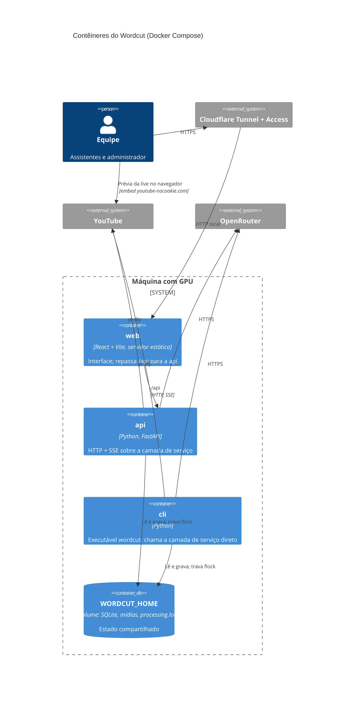
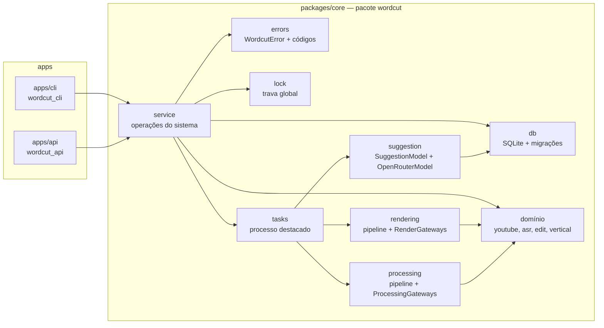
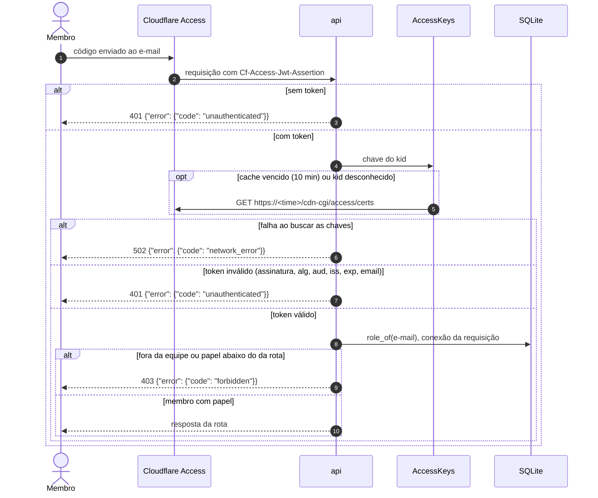

# Arquitetura do Wordcut

Modelo C4 e fluxos principais. As decisões que levam a esta forma estão nas
[ADRs](../adr/README.md). Este documento descreve a arquitetura **alvo do MVP**; a coluna
"Estado" da seção 4 diz o que já existe.

## 1. Contexto (C4 nível 1)


## 2. Contêineres (C4 nível 2)



`api` e `cli` usam o mesmo pacote `core` (camada de serviço e domínio), em processos
separados. O que os coordena é o volume de dados: o banco SQLite e a trava `flock`.

## 3. Componentes do core (C4 nível 3)



## 4. Estado da implementação

| Peça | Estado |
|---|---|
| Monorepo (workspace `uv` com lock único; `apps/web` com npm) | existe |
| Docker Compose (`api`, `web`, `cli` no perfil `tools`; portas só em `127.0.0.1`) | existe; sem GPU e sem WhisperX na imagem (roadmap, item 5) |
| Domínio (`youtube`, `asr`, `edit`, `vertical`, `media`, `sync`, `transcript`, `files`) | existe em `packages/core`; a transcrição roda com o WhisperX local (`asr.local` lança `asr.worker` no ambiente próprio do WhisperX) |
| Erros (`errors`), raiz de dados (`home`), banco com migrações (`db`), trava global (`lock`) | existe em `packages/core` (item 3.1.a.3; ADR-0005, ADR-0006) |
| Tabela `sermons` (migração 0002, repositório `db.sermons`) e pasta de segredos (`config`, `WORDCUT_CONFIG`) | existe em `packages/core` (item 1.1.a.1) |
| Configurações | tabela `settings` chave-valor (migração 0005, repositório `db.settings`) com o modelo do LLM (sem padrão) e o do WhisperX (`large-v3` por padrão); segredos em arquivos de `WORDCUT_CONFIG` com permissão 600 (`openrouter-key` e `youtube-cookies.txt`), gravados de uma vez por `config.write_secret` (temporário na mesma pasta + `os.replace`); a chave só sai mascarada (`••••` e os 4 últimos), os cookies só como presentes ou ausentes; pasta somente leitura dá `config_not_writable` (item 2.1.a.1) |
| Equipe | tabela `members` (migração 0010, repositório `db.members`) com o e-mail (chave, em minúsculas), o papel (`assistant` ou `admin`) e as datas, sem outro dado pessoal; `service.members` lista, inclui, troca o papel e remove, com a regra do último administrador checada e gravada sob `BEGIN IMMEDIATE` (a CLI e a API gravam no mesmo arquivo), e `role_of` dá o papel de um e-mail, ou `None`, para a API (item 1.2.a.1) |
| Critérios e presets | `wordcut.criteria`: textos do prompt no pacote (`criteria/texts/`: `base.md` com vagas para os critérios e as durações, um arquivo por critério com os três níveis, `options/` com reordenar, palavras protegidas e instruções), carregados e validados no primeiro uso (`CatalogError` é erro de programação); tabela `presets` (migração 0006, repositório `db.presets`) com os níveis em JSON por ID de critério, índice único parcial para um só padrão e o "Padrão" semeado com `levels '{}'`; `service.presets` lista, mostra, cria, altera, troca o padrão, apaga (o padrão não), completa critérios novos e ignora removidos na leitura e monta o prompt (`build_prompt`) que a sugestão usa (item 2.1.b.1); o texto dos critérios aguarda revisão humana qualificada (item 2.1.a.2) |
| Camada de serviço | `service.status` (trava e tarefas em andamento), `service.sermons` (criar a pregação pelo link, listar, detalhar com a última tarefa e a transcrição, delimitar e reconciliar a pregação `processing` órfã; itens 1.1.a.1, 1.1.b, 1.1.c.1), `service.processing` (lançar o processamento; item 1.1.c.1), `service.settings` (ver e trocar os modelos, gravar a chave do LLM e os cookies; item 2.1.a.1), `service.presets` (critérios e presets; item 2.1.a.2), `service.cuts` (listar os cortes da pregação com os descartados por último, detalhar e escolher, descartar ou restaurar, gravando só o estado; o texto montado e a duração vêm de `wordcut.cuts.assembly`, que resolve os trechos pela posição das palavras e aplica as correções de grafia do corte; item 1.1.e.1; corrigir a grafia de uma palavra só no corte, com a trava de `wordcut.cuts.spelling` (núcleo da palavra, Levenshtein e limite do protótipo, sempre contra o original), gravando na tabela `word_fixes` (migração 0008, repositório `db.word_fixes`; as duas chaves com `ON DELETE CASCADE`) e marcando o corte como editado; item 1.1.f.2; `show_cut` traz as opções efetivas da próxima exportação e as exportações do corte, com o caminho absoluto; item 1.1.h.1), `service.rendering` (lançar a exportação, estimar a duração sem renderizar e mostrar uma exportação; item 1.1.h.1), `service.tasks` (listar, detalhar e esperar tarefas; item 3.1.a.2) e `service.members` (a equipe e `role_of` para a API; item 1.2.a.1) existem; as demais operações em construção (roadmap, fase 1) |
| Tarefas | tabela `tasks` (migração 0003) e `wordcut.tasks`: registro de tipos, execução em primeiro plano ou em processo destacado que herda a trava (`wordcut.tasks.runner`, saída em `tasks/<id>.log`), gancho `admit` sob a trava antes de gravar a tarefa, progresso no banco e tarefa órfã marcada `interrupted` na leitura; o tipo interno `diagnostic` exercita o mecanismo; o tipo `process` existe (item 1.1.c.1); o tipo `suggest`, sem trava, existe (item 2.1.b.2); o tipo `render`, com trava, existe e devolve `result.render_id` (item 1.1.h.1; ADR-0007, ADR-0013, ADR-0014, ADR-0018) |
| Processamento da pregação | `wordcut.processing`: `pipeline.process` (baixa só a faixa e uma janela de áudio, sincroniza, transcreve, ajusta as bordas às palavras e corta com fades), frases (`processing.sentences`) e a porta `ProcessingGateways` com `LocalGateways`/`default_gateways(whisper_model)`, que transcreve com o modelo do WhisperX das configurações (item 2.1.a.1); tabelas `words` e `sentences` e colunas `sermon_start`, `sermon_end`, `video_path`, `processed_at` em `sermons` (migração 0004, repositório `db.transcripts`); mídias em `media/sermons/<id>/` na pasta de dados; ao fim, a sugestão de cortes pelo LLM com o preset padrão, cuja falha não desfaz o processamento (item 1.1.c.1; ADR-0014, ADR-0016) |
| Sugestão de cortes | `wordcut.suggestion`: entrada (`request`: prompt do preset + formato da resposta; frases numeradas de 1 em diante, sem tempos), validação estrita do esquema (`response`), porta `SuggestionModel` com `OpenRouterModel` (`httpx`, toda falha vira `llm_error`) e `default_model(llm_model, key)`, que os testes substituem e que, como `processing.default_gateways`, recusa com `network_error` enquanto `WORDCUT_FORBID_NETWORK` estiver definida (`wordcut.network`; o `conftest.py` da raiz a define e a tarefa destacada a herda; ADR-0017); `suggest` confere modelo e chave (`llm_not_configured`), pede uma vez e mais uma em resposta fora do esquema, monta trechos e faixa contínua, descarta por duração estimada (×0,82) com aviso e grava os cortes `suggested`; tabela `cuts` (migração 0007, repositório `db.cuts`; `preset_id` com `ON DELETE SET NULL`) e `suggestion_error_code`/`suggestion_error_message` em `sermons`; `sermon show` e `list` trazem cortes e contagens reais (item 2.1.b.1; ADR-0010, ADR-0016); `service.suggestion.start_suggestion` lança a tarefa `suggest` (`wordcut.tasks.suggest`) depois de conferir pregação processada, preset, modelo e chave e a ausência de outra sugestão da pregação em andamento, e `suggest(..., replace_suggested=True)` troca, só no sucesso e numa transação, os `suggested` não editados pelos novos, recusando a gravação se a pregação foi reprocessada no meio (item 2.1.b.2) |
| Exportação do corte | `wordcut.rendering`: `options` (as escolhas de docs/cli.md §8.7, os padrões, a validação e a mescla informado > salvo > padrão), `timeline` (os trechos pela posição das palavras, de `cuts.assembly`, limpos com `edit.timeline.Cleanup`: hesitações, gaguejos e pausas `original`, `natural` ou `short`), `estimate` (a duração sem abrir mídia, à taxa nominal de 30 quadros/s), `pipeline.render_cut` (montagem com ou sem emendas suavizadas, câmera, legendas com as correções por `word_id` e o estilo do corte escalado para 720×1280, codificação com resolução, CRF, normalização e fade, num temporário movido só no sucesso) e a porta `RenderGateways` com `LocalGateways`/`default_gateways()`, que os testes substituem (fixture `no_real_rendering`); tabela `renders` (migração 0009, repositório `db.renders`; `cut_id` com `ON DELETE CASCADE`) e `db.cuts.set_render_options`; arquivos em `media/cuts/<cut_id>/<render_id>.mp4` na pasta de dados (item 1.1.h.1; ADR-0018) |
| CLI | contrato de saída e erros (ADR-0012), erro de uso sem repetir valor digitado (ADR-0015), `wordcut status`, `wordcut sermon create` (com `--process`), `list`, `show` (com `--transcript`), `trim` e `process`, `wordcut task list`, `show` e `wait`, `wordcut settings show`, `set`, `set-key` e `set-cookies` (segredo só pelo stdin; argumento sobrando recusado sem eco), `wordcut criteria list`, `wordcut preset list`, `show`, `create`, `update`, `set-default` e `delete`, `wordcut cut list`, `show`, `preview`, `choose`, `discard`, `restore`, `fix-word`, `caption` e `render` (com `--estimate` e `--wait`), `wordcut member list`, `add`, `set-role` e `remove`, `wordcut render list`, `show` e `download`, `wordcut sermon download` e `suggest` e o auxiliar de `--wait` dos comandos que lançam tarefa existem; todo comando segue o contrato; a CLI anterior saiu com o código que só ela usava (item `cli-migration`) |
| API | `apps/api` (`wordcut_api`): `GET /api/health`, sem identificação e sem banco; identidade pelo Cloudflare Access (`identity`: JWT RS256 de `Cf-Access-Jwt-Assertion` com `aud`, `iss`, `exp` e `email`, chaves do time pela porta `KeySource` com `AccessKeys` em cache de 10 min e nova busca em `kid` desconhecido, atrás da guarda de rede); configuração por ambiente (`settings`: `WORDCUT_ACCESS_TEAM_DOMAIN`, `WORDCUT_ACCESS_AUD` e `WORDCUT_DEV_EMAIL`, só sem Access; Access pela metade recusa subir); papéis (`auth`: `CurrentMember` e `require(papel)`, papel por `service.members.role_of` numa conexão por requisição); erros (`errors`: `WordcutError` como `{"error": …}` com o status da saída, `unauthenticated` 401, `forbidden` 403, exceção inesperada 500 `internal_error`); `GET /api/me` devolve e-mail e papel (item 1.2.a.2; ADR-0009, ADR-0019); rotas de pregações, tarefas e estado (`routes.sermons`, `routes.tasks`, `routes.status`; item 20a, ADR-0020): `POST/GET /api/sermons`, `GET/PATCH /api/sermons/{id}`, `POST /api/sermons/{id}/process`, `POST /api/sermons/{id}/suggest` (administrador), `GET /api/sermons/{id}/video`, `GET /api/tasks`, `GET /api/tasks/{id}`, `GET /api/tasks/{id}/events` (SSE por polling do banco, `sse`), `GET /api/status`, com conexão aberta e fechada no corpo da rota e o YouTube em `deps.live_source()`; requisição malformada dá 400 `invalid_argument` sem eco e rota inexistente 404 `not_found`; OpenAPI em `/api/docs` só em desenvolvimento ([docs/api.md](../api.md)); rotas de cortes, exportações, configurações, critérios, presets e equipe (`routes.cuts`, `routes.renders`, `routes.settings`, `routes.presets`, `routes.members`; item 20b, ADR-0021): `GET /api/sermons/{id}/cuts`, `GET /api/cuts/{id}`, `GET /api/cuts/{id}/preview`, `POST /api/cuts/{id}/choose`, `/discard` e `/restore`, `PUT /api/cuts/{id}/words/{word_id}`, `GET/PATCH/DELETE /api/cuts/{id}/caption`, `POST /api/cuts/{id}/renders` (202), `GET /api/cuts/{id}/renders/estimate`, `GET /api/cuts/{id}/renders`, `GET /api/renders/{id}` e `GET /api/renders/{id}/file`, e, só para o administrador, `GET/PATCH /api/settings`, `PUT /api/settings/llm-key` e `/youtube-cookies` (segredo só no corpo, nunca devolvido; 409 `config_not_writable` com `/config` só leitura), `GET /api/criteria`, `/api/presets` (listar, criar, detalhar, alterar, `set-default`, apagar) e `/api/members` (listar, incluir, `set-role`, `remove`, com o e-mail só no corpo); os routers estão em `routes.ROUTERS`, que o `create_app` inclui num laço com a identidade, e os de administração declaram `require("admin")`; as exportações saem sem `path`; os corpos são estritos (`bodies`: campo desconhecido, tipo errado e `null` recusados), e um campo ou parâmetro desconhecido dá 400 sem o nome |
| Web | `apps/web` (item 21; ADR-0022): rotas `/`, `/sermons/:id`, `/cuts/:id` e `/settings` pelo React Router (`app/routes.tsx`); cliente HTTP tipado (`api/client.ts`, `api/types.ts`) que devolve `ApiError` com o objeto de erro da API, `unavailable` para corpo que não é JSON e `network_error` para a API fora do ar; identidade por `GET /api/me` antes das telas, com tela própria para 401 e 403; topo com o caminho dos três níveis (títulos de `GET /api/sermons/{id}` e `GET /api/cuts/{id}`) e a entrada de Configurações só para o administrador; nível 1 com a lista (data, título, estado e duração), estado vazio e o diálogo "Nova pregação" (aviso de live no ar, motivo junto ao campo); barra de status por consulta a `GET /api/status` a cada 3 s; configurações em tela inteira com navegação lateral, recusadas ao assistente; indicador "Salvo"; visual do protótipo (`ui/tokens.css`, Geist e, na legenda do nível 3, Open Sans 700 pelo npm). Nível 2 (item 22; ADR-0023) em `features/sermon`: prévia pela porta `PlayerLike` (embed do YouTube antes do processamento e fora do trecho processado, `<video>` de `GET /api/sermons/{id}/video` dentro dele, com o tempo da live convertido), timeline com régua em tempo da live e o clipe entre as bordas (sem miniaturas nem forma de onda, que a API não serve), bordas por arraste e I/O salvas por `PATCH`, Processar/Reprocessar com o progresso no botão por `EventSource` (`useTaskEvents`, fechado no `done`/`failed` e ao sair da tela). Painel de cortes do nível 2 (item 23) em `features/sermon`: `CutsPanel` lê `GET /api/sermons/{id}/cuts` só na pregação processada e de novo quando ela recarrega ou depois de descartar/restaurar, sem reordenar no cliente; `CutCard` abre o corte (`POST /api/cuts/{id}/choose` só no sugerido, navegação depois da resposta) e tem o menu "Mais ações" (`discard`/`restore`); `CutLayers` desenha cada corte como camada da `Timeline` (prop `layers`), do `start` ao `end` do corte somados ao `sermon_start`, só para leitura. Nível 3 (item 24) em `features/cut`: `CutPage` lê `GET /api/cuts/{id}`, `GET /api/cuts/{id}/preview` e a pregação (para o `sermon_start`); `CutPreview` toca só o `<video>` de `GET /api/sermons/{id}/video` pela porta `PlayerLike`, recortado em 9:16 por CSS, e salta de trecho em trecho com o controlador puro `sequence.ts` (`next(segments, index, t)`, que vai pelo trecho tocando e não só pelo tempo, e a única conversão entre tempo da pregação e da live); `captions.ts` monta os blocos e a palavra atual em tempo do corte e converte o estilo (px do quadro 1080 em `cqw`) em custom properties da legenda; `CutTimeline` mostra só o corte, em tempo do corte, com as camadas Legenda e Vídeo; abas Texto e Legenda (`CutSide`), formulário do estilo com autosave por campo (`useCaptionStyle`, `PATCH`/`DELETE /api/cuts/{id}/caption`) e grafia por clique duplo (`WordEditor`, `useWordFixes`, `PUT /api/cuts/{id}/words/{word_id}`), com a lista de correções e Desfazer. Exportação (item 25) em `features/cut`: `ExportButton` na barra do nível 3 abre o menu com "Exportar 9:16…" e a lista (`RendersList`, com Baixar por `<a href download>` para `GET /api/renders/{id}/file` e o resumo de `exportSummary.ts`), segue a tarefa `render` por `useTaskEvents` (a lançada ou a de `running_tasks` com o `cut_id`) e não exporta com a trava presa, nem pelo próprio corte; `ExportDialog` parte de `render_options` com a Legenda de `useCaptionStyle` e pede a estimativa por `useEstimate` (300 ms de espera, `AbortController`); no `done`, `useCutExports` relê o corte e `GET /api/cuts/{id}/renders`. Configurações (item 26) em `features/settings`: as seções Modelo, Presets, Filtros, Valor, Formato e Pessoas numa só rolagem, com o menu marcado por `useScrollSpy` (`IntersectionObserver` sobre as seções e o fim da página); linhas de formulário de `ui/FormRow.tsx`, também usado pela caixa de exportação; `ModelSection` lê `GET /api/settings`, salva os modelos por `PATCH` ao Enter ou ao sair do campo (`CommitInput`) e envia a chave (`PUT …/llm-key`) e o arquivo de cookies (`PUT …/youtube-cookies`) sem guardá-los em estado nem mostrá-los de volta; `PresetSections` lê `GET /api/presets` e `GET /api/criteria` e salva cada campo do preset escolhido por `PATCH /api/presets/{id}` com `usePresetDrafts` (400 ms de espera, rascunhos e erros por preset, gravação pendente concluída antes de trocar de preset), mais Duplicar, Tornar padrão e Apagar; `TeamSection` usa as rotas de `members` com o e-mail só no corpo e relê `GET /api/me` quando o administrador muda o próprio papel; um único `Saved` para a tela |

## 5. Fluxos

### 5.1. Criar e processar uma pregação pela CLI

```mermaid
sequenceDiagram
  autonumber
  actor Op as Operador
  participant CLI as wordcut (cli)
  participant SVC as core.service
  participant DB as SQLite
  participant Child as processo destacado
  participant Lock as processing.lock
  participant YT as YouTube
  participant ASR as WhisperX + ffmpeg
  participant LLM as OpenRouter

  Op->>CLI: sermon create <link> --start T --end T
  CLI->>SVC: create_sermon(link, start, end)
  SVC->>YT: dados da live
  SVC->>DB: grava a pregação delimitada
  SVC-->>CLI: pregação (id, título, duração)
  Op->>CLI: sermon process <id>
  CLI->>SVC: start_processing(id)
  SVC->>DB: pré-condições (bordas, live terminada, --force)
  SVC->>Lock: flock exclusivo (não bloqueante)
  alt trava ocupada
    SVC-->>CLI: WordcutError busy
    CLI-->>Op: saída 4
  else livre
    SVC->>DB: revalida e grava a pregação processing (gancho admit)
    SVC->>DB: tarefa running (PID do lançador)
    SVC->>Lock: dono = task_id
    SVC->>Child: lança em sessão própria (herda o descritor da trava)
    SVC->>Lock: fecha a sua cópia do descritor
    SVC->>DB: PID do filho na tarefa
    SVC-->>CLI: task_id
    CLI-->>Op: {"task_id": …}
    Child->>Lock: dono = PID do filho
    Child->>DB: confirma processing; com --force, apaga cortes, palavras e frases
    Child->>YT: baixa só a faixa e a janela de áudio
    Child->>ASR: sincroniza, transcreve a faixa, corta 16:9 com fades
    Child->>DB: palavras, frases e processed (uma transação)
    Child->>LLM: prompt do preset padrão + frases numeradas (uma chamada, mais uma se fora do esquema)
    alt resposta válida
      Child->>DB: cortes suggested, suggestion_error limpo
    else sem configuração, falha do OpenRouter ou fora do esquema duas vezes
      Child->>DB: suggestion_error (a pregação continua processed)
    end
    Child->>Lock: libera
    Child->>DB: tarefa succeeded
  end
```

O lançador trava antes de criar a tarefa e o filho herda a trava; o filho a solta antes de
gravar o fim, para que `task wait` termine com a máquina livre
([ADR-0013](../adr/0013-trava-herdada-pelo-processo-da-tarefa.md)). A pregação fica
`processing` desde o lançamento; se o processo morrer, a próxima leitura a deixa `failed`
([ADR-0014](../adr/0014-processamento-por-portas-e-estado-na-leitura.md)).

### 5.2. Exportar um corte pela CLI

```mermaid
sequenceDiagram
  autonumber
  actor A as Assistente
  participant CLI as wordcut (cli)
  participant SVC as core.service
  participant Lock as processing.lock
  participant DB as SQLite
  participant Task as tarefa render
  participant GW as RenderGateways (ffmpeg + OpenCV)

  A->>CLI: cut render <id> [opções] --wait
  CLI->>SVC: start_render(cut_id, opções)
  SVC->>SVC: valida as opções
  SVC->>DB: corte existe; pregação processed com o vídeo
  SVC->>Lock: flock exclusivo (não bloqueante)
  alt trava ocupada
    SVC-->>CLI: WordcutError busy
    CLI-->>A: saída 4, nada gravado
  else livre
    SVC->>DB: revalida; grava as opções e a legenda no corte (gancho admit)
    SVC->>DB: tarefa running
    Task->>DB: lê trechos, correções e estilo da legenda
    Task->>GW: montagem, detecção, codificação (temporário em media/cuts/<id>/)
    alt falha ou Ctrl+C
      Task->>Task: apaga o temporário e a pasta de trabalho
      Task->>DB: tarefa failed (internal_error ou interrupted)
    else sucesso
      Task->>DB: linha em renders e os.replace para <render_id>.mp4 (uma transação)
      Task->>DB: tarefa succeeded, result.render_id
      CLI->>SVC: show_render(render_id)
      CLI-->>A: {id, cut_id, path, duration, created_at, options}
    end
  end
```

`--estimate` não passa pela trava nem pela tarefa: `estimate_render` lê o corte e as palavras
e calcula a duração da timeline, sem abrir mídia e sem gravar nada
([ADR-0018](../adr/0018-exportacao-por-portas-sem-arquivo-parcial.md)).

### 5.3. Exportar um corte pela web

```mermaid
sequenceDiagram
  autonumber
  actor A as Assistente
  participant Web as web
  participant API as api
  participant SVC as core.service
  participant Lock as processing.lock
  participant DB as SQLite

  A->>Web: Exportar (opções)
  Web->>API: GET /api/cuts/{id}/renders/estimate?opções
  API->>SVC: estimate_render(cut_id, options), sem trava nem tarefa
  API-->>Web: 200 {"duration", "options"}
  Web->>API: POST /api/cuts/{id}/renders {opções}
  API->>SVC: start_render(home, cut_id, options, detach=True)
  SVC->>Lock: flock exclusivo
  alt ocupada
    API-->>Web: 409 {"error": {"code": "busy"}}
  else livre
    SVC->>DB: opções salvas no corte; tarefa running
    API-->>Web: 202 {"task_id", "kind", "status", "cut_id"}
    Web->>API: GET /api/tasks/{id}/events (SSE)
    loop progresso
      API-->>Web: event: progress
    end
    SVC->>DB: exportação registrada; tarefa succeeded
    API-->>Web: event: done (result.render_id)
    Web->>API: GET /api/cuts/{id} e GET /api/cuts/{id}/renders
    A->>Web: Baixar
    Web->>API: GET /api/renders/{render_id}/file
    API-->>Web: 200 video/mp4, AAAA-MM-DD - Título do corte.mp4
  end
```

A exportação chega à web sem `path`, o caminho local que a CLI mostra; o arquivo vem só por
`GET /api/renders/{id}/file`
([ADR-0021](../adr/0021-rotas-de-cortes-e-administracao-na-api.md)).

### 5.4. Identificar quem chama a API



Sem o Access configurado, `WORDCUT_DEV_EMAIL` faz o papel do token, só em desenvolvimento, e
também passa por `role_of`
([ADR-0019](../adr/0019-identidade-e-erros-na-api.md)).

### 5.5. Processar uma pregação pela web

```mermaid
sequenceDiagram
  autonumber
  actor A as Assistente
  participant Web as web
  participant API as api
  participant SVC as core.service
  participant Lock as processing.lock
  participant DB as SQLite
  participant Task as tarefa process

  A->>Web: Processar (Reprocessar manda {"force": true})
  Web->>API: POST /api/sermons/{id}/process {}
  API->>SVC: start_processing(home, id, live, force, detach=True)
  SVC->>DB: pregação delimitada; live terminada
  SVC->>Lock: flock exclusivo (não bloqueante)
  alt ocupada
    API-->>Web: 409 {"error": {"code": "busy"}}
  else livre
    SVC->>DB: pregação processing; tarefa running
    SVC->>Task: processo destacado, herda a trava
    API-->>Web: 202 {"task_id", "kind", "status", "sermon_id"}
    Web->>API: GET /api/tasks/{task_id}/events (SSE)
    API->>DB: 404 antes do fluxo se a tarefa não existe
    loop a cada 0,5 s até o fim
      API->>DB: show_task (reconcilia tarefa órfã)
      opt progresso mudou
        API-->>Web: event: progress (a tarefa)
      end
      opt 15 s sem evento
        API-->>Web: : ping
      end
    end
    Task->>DB: pregação processed; tarefa succeeded
    API-->>Web: event: done (a tarefa, com result) e fecha o fluxo
    Web->>Web: fecha o EventSource
    Web->>API: GET /api/sermons/{id} (recarrega como processada)
  end
```

Na web, o progresso aparece no botão pelos eventos; a barra de status continua pela consulta
de 3 s a `GET /api/status` ([ADR-0022](../adr/0022-arquitetura-do-cliente-web.md)). Ao abrir
uma pregação `processing`, a web segue a tarefa por `last_task.id`. A prévia do nível 2 é a
porta `PlayerLike`, com o embed do YouTube e o vídeo processado como implementações
([ADR-0023](../adr/0023-previa-da-live-pelo-embed-do-youtube.md)).

Fechar a página só fecha o fluxo: a tarefa continua no processo dela. Uma falha termina em
`event: failed`, com o objeto de erro em `error`
([ADR-0020](../adr/0020-rotas-e-progresso-por-sse-na-api.md)).
